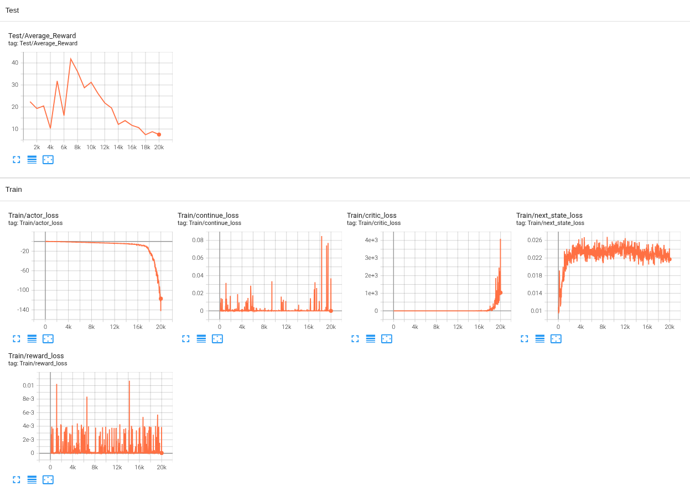

# Under-Construction
The 2018 World Model that I implemented last time failed to achieve satisfactory results due to prediction errors in world model, long training time of LSTM, inefficiency of gradient-free ES, and other practical limitations. I found Dreamer V1–V3, improved versions of the 2018 World Model, which demonstrated their ability to perform articulation control, so I decided to implement Dreamer rather than continuing with the previous one.

Although I continued trying to implement V1, it failed to achieve any meaningful performance, and I could not find out what caused the problem. So, I tried another approach that was using SAC that I had previously implemented as a starting point, and I could find out what caused the problem: RSSM (Recurrent State-Space Model). RSSM is a method that uses GRU, latent, and prior/posterior. The training was unsuccessful when I used these components together or separately, but successful when I simply used an MLP to predict the next state. RSSM can be beneficial for high-dimensional inputs like pixel values because predicting low-dimensional latent is easier than predicting high-dimensional values. However, I failed to get successful results with my RSSM implementation, even in vector-state environment where prediction is easier than predicting pixel values. So, if I plan to use RSSM with image inputs in the future, I will first need to find ways to make it work well with vector-state inputs.

Unlike the 2018 World Model, Dreamer iteratively updates the world model and actor-critic, allowing the world model to continuously learn from new experiences. However, simply implementing this idea was not sufficient to achieve successful training in the fourleg locomotion Unity environment, where the agent resets whenever its knees touch the ground. By applying some techniques from V1–V3 that showed good results within a short training time and that I wanted to implement, I was finally able to achieve successful training. Because this implementation does not include all the key components of Dreamer, I named it Dreamer-inspired.

To try something new in Unity as well, I added a Ray Perception Sensor 3D to move forward while avoiding walls. The results can be found in the Training Progress section.

DreamerV1 — [*DREAM TO CONTROL: LEARNING BEHAVIORS BY LATENT IMAGINATION*](https://arxiv.org/pdf/1912.01603) 
DreamerV2 — [*MASTERING ATARI WITH DISCRETE WORLD MODELS*](https://arxiv.org/pdf/2010.02193) 
DreamerV3 — [*Mastering Diverse Domains through World Models*](https://arxiv.org/pdf/2301.04104)

## Diagram

Here are some of the techniques applied in this implementation.

### Adaptive Gradient Clipping

Before updating parameters, gradient clipping is often used to prevent gradient explosion by limiting the magnitude of gradients. I have used a gradient clipping method that limits the gradient magnitude to 1 for all parameters so far. But here, the adaptive method is used to limit the gradient magnitude relative to the size of each parameter. If the gradient magnitude exceeds 30% of the parameter magnitude, the gradient is reduced to 30% of the parameter magnitude. 1e-3 is added to the parameter magnitude so that gradients are not clipped to become too small when the parameter magnitude is already small. The reason for comparing the gradient with the parameter is that gradient can be relatively large or small depending on the size of the parameter. So, this adaptive method can better handle increases in gradient magnitude than the fixed-threshold method.

### Adam vs <ins>LaProp</ins>

Before going into detail, Adam stands for Adaptive Moment Estimation, and LaProp, I could not find what exactly it stands for, seems to stand for Learning rate Adaptive Propagation. Both use momentum to adjust learning rate for each parameter, so the names do not really distinguish between them. The main difference lies in the order of computing GM and GSM.

Looking at Adam first, GM adjusts the update direction, while GSM adjusts the update magnitude, and both use momentum that gives more weight to previous values to avoid being overly affected by sudden changes in the gradient. And then, since both GM and GSM are initially 0, correction is applied to prevent them from becoming too small at the beginning. Finally, The learning rate is multiplied by GM and divided by the square root of GSM.

For LaProp, however, GSM is first calculated to obtain the normalized gradient, and then this normalized gradient is used to calculate GM. The reason for using the normalized gradient is to reduce the effect of the gradient's magnitude when calculating GM, allowing GM to focus more on its direction. This helps world models, where accuracy is important, converge smoothly by reducing sudden changes in updates, although it may lose some useful gradient magnitude information. β₂ is set to 0.99 instead of 0.999 to respond more quickly to recent changes, and ε is set to 10⁻²⁰ instead of 10⁻⁸ to minimize its effect on normalization. However, if √GSM becomes as small as 10⁻²⁰, the normalized gradient can become extremely large. Because gradients are usually not that small to make √GSM extremely small and this process is not the final operation, this is unlikely to cause a problem.

### Actor Loss

There are two possible forms of the actor loss. The former optimizes the return, which is used in V1 and V2 for continuous actions. The latter optimizes the probability of actions based on the advantage, which is used in V3 for both discrete and continuous actions. Because imagined trajectories are differentiable in world model, backpropagation can directly compute how past actions affect the future, which is one of the key capabilities in world model. The former can use this capability, whereas the latter cannot. This is because adjusting the action probability requires stopping the gradient of the advantage, which also stops the gradient of the imagined states that make this capability possible. I think there are two reasons why V3 does not use this capability. First, even if the model predicts well, it cannot predict perfectly due to its approximate nature, which causes small errors to accumulate over the imagined trajectory, making the gradients inaccurate. Second, optimizing the action probabilities provides a more specific learning signal than optimizing the return. Therefore, it seems that V3 was able to obtain diamonds in Minecraft without using this capability because of these reasons and because it could use imagination to predict and experience situations it had never encountered before.

However, when I tried both approaches in my environment, the former, which uses this capability, achieved better training performance. I think this is because the imagination horizon was set to 2, which is shorter than the horizon of 15 used in V3, allowing the benefits of this capability to outweigh the negative effects of accumulated prediction errors and less direct learning signals. Therefore, which actor loss to use depends on the trade-offs in the given situation.

### Additional Settings
- **horizon = 2**: To demonstrate that learning is possible from imagination to imagination.
- **target_critic**: To prevent critic loss from exploding.
- **world_model_num_updates = 8**: To train on the same batch multiple times.
- **online_buffer**: To include the latest data in each batch.
- **ac_update_start = 5000**: To sufficiently train the world model before starting actor–critic update.
- **ac_update_interval = 4**: To train the world model on diverse batches before actor-critic update.

With these settings, horizon 5 caused large spikes in critic loss, likely due to accumulated prediction errors. Horizon 1 avoided this problem, while horizon 2 caused only minor spikes without disrupting training. Increasing `world_model_num_updates` and `ac_update_interval` may potentially mitigate this problem and enable higher horizons, but the training time would be much longer.

## Training Progress

This was conducted in a more difficult environment where two additional legs and a ray sensor were added to the fourleg mentioned above, with the goal of moving forward. Although the agent had seen only a small amount of data in the early stages, the reward increased quickly, and the agent was able to achieve forward movement. However, in the middle and later stages of training, the critic loss exploded, causing the actor loss to explode as well. This may be because the critic increasingly overestimated the return as the locomotion speed and reward increased. When using horizon 1, exploding was reduced, but the best performance was lower than this result. When using SAC, the best performance was much higher. Moreover, when further training to move forward while avoiding walls, the training did not go well, but SAC succeeded. These results show that the current code implementation has reached its limit.

## Conclusion
After many trials and errors, I successfully trained the actor and critic in imagination, enabling the agent to move forward. In particular, it was impressive that the reward increased rapidly to a certain level with fewer updates than SAC. However, it was disappointing that the performance was limited by the critic loss divergence. The results showed that the agent could learn simple tasks well, but struggled to learn more difficult tasks. Without solving this problem, this code can still be useful for training with limited data and achieving a certain level of performance, providing a starting point for further training.
